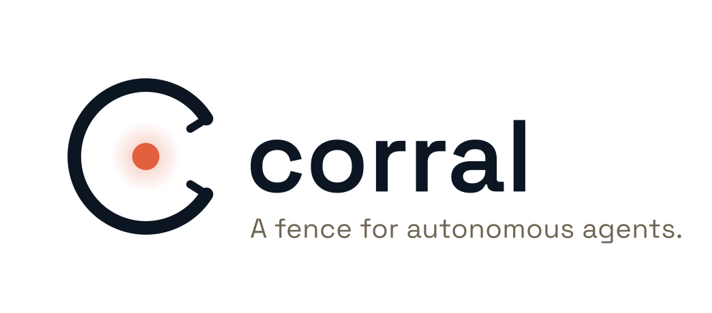

<h1 align="center">
  <picture>
    <source media="(prefers-color-scheme: dark)" srcset=".github/corral-lockup-on-dark.svg">
    
  </picture>
</h1>

corral runs AI agents inside a fence. You say what each agent may reach,
corral holds it to that, asks you before anything else happens, and keeps a
record of everything.

> **Status: under construction.** The supervisor that ties the parts together
> is not finished yet. See [What works today](#what-works-today).

## What corral is for

Agents that run commands and read the web are useful, and they read things
you did not write. corral is for running them without having to trust them.

- **A fence.** Each agent gets a list of hosts, ports and folders. It reaches
  nothing else, and that is enforced from outside the agent, by a sandbox and
  a firewall.
- **A gate.** When an agent wants something that is not on its list, the
  request comes to you. No answer means no.
- **A record.** Every start, stop, grant and refusal goes into one log.

corral is neither an agent nor a sandbox. It is the supervisor between them:
it starts the agent program inside the sandbox tool you chose and does the
bookkeeping. It is made for one person on one machine.

## What works today

| Command | State |
|---|---|
| `corral version` | works |
| `corral netns`, the network fence for one agent | works, on its own too; needs root through sudo |
| `corral approvald`, the gate for a sandbox's permission requests | works, on its own |
| `corral run` and the client commands | not yet |

## Setup

corral is a single static binary for Linux. To build it you need Go 1.27 or
newer.

```sh
git clone https://github.com/txber/corral
cd corral
CGO_ENABLED=0 go build -trimpath -ldflags "-s -w" -o corral ./cmd/corral
sudo install -m 755 corral /usr/local/bin/corral
```

Run the tests with `go test ./...`.

## Use

```sh
corral version
```

The supervisor is not finished, but the network fence and the gate can be
used on their own.

### `corral netns`: a network fence for one agent

`corral netns` gives an agent a network namespace of its own, with firewall
rules that let it reach only its targets and one proxy port on this machine.
It runs as root through sudo.

```sh
sudo corral netns up    <agent_id> <slot> [--target <target>]...
sudo corral netns allow <agent_id> <slot> --target <target> [--target <target>]...
sudo corral netns exec  <agent_id> --env-file <path> -- <command> [<arg>...]
sudo corral netns down  <agent_id> <slot>
sudo corral netns list
```

- `up` creates the namespace, a veth pair joining it to this machine, and the
  agent's rules. It refuses an agent id or a slot that is in use. It records
  the agent first, so `down` can also clear what an interrupted `up` left.
- `allow` adds targets to a running agent; open connections stay open.
- `exec` runs a command, given by its absolute path, inside the namespace as
  the user who called sudo: without capabilities, with `no_new_privs` set so
  that nothing it starts can gain privileges again, and with exactly the
  variables of the env file as its environment. The env file must belong to
  that user, have mode 600, and hold at most 64 lines of `KEY=VALUE` in at
  most 64 KiB. No root process ever holds its variables: the file is read
  only after the drop to the user, by `corral netns enter`, which `exec`
  starts itself and which is not meant to be called directly.
- `down` stops what runs in the namespace and removes the namespace, the veth
  pair and the rules. It succeeds when there is nothing left to remove, and
  fails, after removing the rest, if a process would not stop.
- `list` prints one `<agent_id> <slot>` line per agent.

An agent id is a lowercase letter followed by up to 11 lowercase letters or
digits. A slot is a number from 1 to 250. A target is
`<ip[/prefix]>:<tcp|udp>:<port[-port]>`, for example `192.0.2.7:udp:53` or
`10.10.4.0/24:tcp:1-1024`. Agent `<id>` in slot `<n>` gets:

| What | Name or address |
|---|---|
| namespace | `oc-<id>` |
| veth, this machine's end | `ocv<n>`, `198.18.<n>.1/30` |
| veth, the agent's end | `eth0`, `198.18.<n>.2/30` |
| proxy port | `198.18.<n>.1`, TCP `18000+<n>` |
| rules | chains, sets and a log limit named `*_<id>` in table `inet corral` |
| record | `/run/corral/<id>` |

Dropped traffic goes to the kernel log with the prefix `corral-drop <id> `,
at most 10 lines a second per agent. The table `inet corral` stays in place
once created, also after the last `down`: its base rules keep any leftover
`ocv*` interface closed.

What it needs:

- `ip`, `nft`, `nsenter` and `setpriv` in `/usr/sbin`, `/usr/bin`, `/sbin` or
  `/bin`;
- IPv4 forwarding (`net.ipv4.ip_forward = 1`), which it does not switch on
  itself;
- a sudoers file, if a supervisor is to call it without a password. With the
  binary installed root-owned as `/opt/corral/bin/corral`:

  ```
  Cmnd_Alias CORRAL_NETNS = /opt/corral/bin/corral netns *
  Defaults!CORRAL_NETNS !pam_session
  you ALL=(root) NOPASSWD: CORRAL_NETNS
  ```

  `!pam_session` keeps the launched command in the calling user's cgroup.
  Whoever holds this grant controls every agent's namespace: the helper
  records no owners and is made for one operator.

What it does not do: it starts no sandbox and no proxy, resolves no host
names, passes no IPv6 (off on this machine's end of each pair, and dropped by
the rules), changes no system setting, keeps nothing across a reboot, and
refuses to run inside any network namespace but the machine's own.

### `corral approvald`: answers a sandbox's permission requests

`corral approvald` answers a sandbox's run-time permission requests from a
scope file such as [`examples/scope.toml`](examples/scope.toml). It grants a
folder listed in `paths`, with everything below it, and a host when every
address the sandbox resolved it to is covered by `targets`. It denies
everything else.

Put its socket in a folder that only you can write and the sandboxed program
cannot, not below `/run` or `/tmp`, and keep the path under 108 bytes:

```sh
mkdir -p -m 700 ~/.local/state/corral
corral approvald --socket ~/.local/state/corral/approval.sock --scope scope.toml
```

It prints one JSON line per answer it sent and per request it refused itself
(malformed, too large, too slow), and stops on Ctrl-C or SIGTERM. A bad
command line or scope file exits with 2, a socket it cannot serve with 1.

Which sandbox can use it, and how to point that sandbox at it, is in
[Built-in integrations](#built-in-integrations).

## Configuration

The supervisor (`corral run`, not finished yet) reads two TOML files;
`examples/` has a complete copy of each.

- `corral.toml` says where the model gateway is (`[gateway]`), which paths
  corral uses (`[paths]`), how many agents may run at once (`max_agents`) and
  which integration serves as sandbox, runtime and key proxy (`[sandbox]`,
  `[runtime]`, `[key_proxy]`, each with a `use` key and that integration's own
  options). See `examples/corral.toml`.
- `roles.toml` has one table per kind of agent a job may start: its network
  mode, model, limits, prices and options for the runtime. See
  `examples/roles.toml`.

A key that corral does not know is an error, and the message names it. A `~`
at the start of a path is the home folder.

## Integrations

corral does not confine or run anything itself. It drives three kinds of
tool, each behind a small interface in the package `integration`:

- a **sandbox** that confines one agent process,
- a **runtime**, the agent program and its control protocol,
- a **key proxy** that lets an agent use the model gateway without holding
  its key.

A tool is added by a Go package that implements one of the interfaces and
registers itself under a name; the configuration then picks it by that name.

The tools compiled into corral, and how to set them up, are listed under
[Built-in integrations](#built-in-integrations).

## Built-in integrations

### nono: sandbox and key proxy

[nono](https://nono.sh) confines a process on Linux with Landlock and
seccomp. It is registered as `nono` for `[sandbox]` and `[key_proxy]`.

**Install.** corral is tested with nono 0.82.0, the asset
`nono-v0.82.0-x86_64-unknown-linux-gnu.tar.gz` of
[its release](https://github.com/nolabs-ai/nono/releases/tag/v0.82.0) (check
it against `SHA256SUMS.txt`), which holds the one binary `nono`. Install it
root-owned below `/opt`, which nono's default profile keeps out of a
sandbox's reach, and keep no copy in `/usr/bin`, `/usr/local/bin` or
anywhere else a sandbox can read or a scope's `paths` grant: a sandboxed
program that can run nono could start a sandbox of its own with other rules.

```sh
sudo install -D -m 755 nono /opt/nono/bin/nono
/opt/nono/bin/nono setup --check-only   # checks kernel support, creates nothing
```

**Configure.** The only option is `binary`, nono's absolute path (no `~`).
`[key_proxy]` takes the same two lines:

```toml
[sandbox]
use = "nono"
binary = "/opt/nono/bin/nono"
```

nono reads the key from `[gateway]`'s `key_file` outside the sandbox and
sends it as `Authorization: Bearer <key>`; the agent reaches the gateway at
`/<name>/` below the address it is given. `endpoints` are matched below `upstream`: with
`https://gateway.example/v1`, write `GET /models` for `/v1/models`. Other
endpoints get 403.

**Roles.** nono reads `memory` (such as `"2G"`), `max_processes` (0 means no
limit) and `network`:

- `"none"`: nono's own network lock stays on and it serves the gateway inside
  the sandbox; other hosts go to the approval socket, raw UDP and direct TCP
  are refused. No key proxy is used.
- `"direct"`: the agent runs in its own namespace
  ([`corral netns`](#corral-netns-a-network-fence-for-one-agent)); nono
  confines files and processes, and `nono proxy` serves the gateway.
- `"proxy"` is refused.

**The system must offer:**

- Landlock ABI 4 or newer, as tested (nono needs it for per-port TCP rules);
  `nono setup --check-only` reports it.
- For `memory` and `max_processes`: `cpu`, `memory` and `pids` delegated to
  your systemd user manager (see
  `/sys/fs/cgroup/user.slice/user-$(id -u).slice/user@$(id -u).service/cgroup.controllers`),
  and nono started inside it, for example under
  `systemd-run --user --wait --pipe --collect`; a login shell is not enough.
  For `"direct"` this also needs `!pam_session` in the sudoers entry.
- A short `paths.state`: each agent's approval socket in it must fit in
  107 bytes.

**Limits today.** nono 0.82.0 asks about a host before resolving it, so every
network request is denied (`no resolved addresses for host`) and `targets`
have no effect yet. Ordinary programs ask for files outside their grants
(curl reads `/proc/sys/crypto/fips_enabled`), so expect such denials in the
log.

**`corral approvald` with nono on its own.** Point the profile at the socket.
approvald answers 2 seconds before `timeout_secs` runs out, with a denial if
no decision was made:

```json
{
  "extends": "default",
  "linux": { "af_unix_mediation": "pathname" },
  "security": {
    "capability_elevation": true,
    "approval_backends": {
      "corral": { "type": "webhook", "url": "unix:///home/you/.local/state/corral/approval.sock", "timeout_secs": 30 }
    },
    "approval_defaults": { "backend": "corral" }
  }
}
```

This sends file requests only. For host requests, also set
`network.approval_backends` and `network.approval_defaults` in the same
shape; that turns on nono's proxy and rules out `--block-net`.

### pi: runtime

[pi](https://github.com/earendil-works/pi) is a coding agent; corral runs it
in its RPC mode. It is registered as `pi` for `[runtime]`.

**Install.** corral is tested with pi 1.6.0, the archive
`pi-linux-x64.tar.gz` of
[its release](https://github.com/earendil-works/pi/releases/tag/v1.6.0). pi
loads assets from next to its executable, so keep the unpacked folder
together, for example as `/usr/local/lib/pi/`. Set `binary` to the
executable in it, not to a link elsewhere: the agent may read the folder
that holds `binary`.

**Configure.** The gateway must speak the OpenAI chat-completions API, for
example with the endpoints `POST /chat/completions` and `GET /models`.

```toml
[runtime]
use = "pi"
binary = "/usr/local/lib/pi/pi"
headers = { X-Team = "research" }   # optional, literal text sent to the gateway
```

**Roles.** `model` is the model id. In the role's options:

```toml
[worker.options]
thinking = "medium"   # off, minimal, low, medium, high, xhigh or max
tools = ["read", "edit", "write", "bash", "grep", "find", "ls"]
```

`tools` replaces pi's default set (`read`, `bash`, `edit`, `write`), so list
every tool the agent should have.

pi's `PATH` is `/usr/local/bin:/usr/bin`, so programs its `bash` tool should
find by name must be there. Its home, temporary files and sessions live in
the agent's working folder; extensions, skills, context files such as
`AGENTS.md` and MCP are off.

**Limits today.** No corral command starts pi yet: `corral run` is not
finished, and the integration has only unit tests.

## License

Apache-2.0, see [LICENSE](LICENSE).
